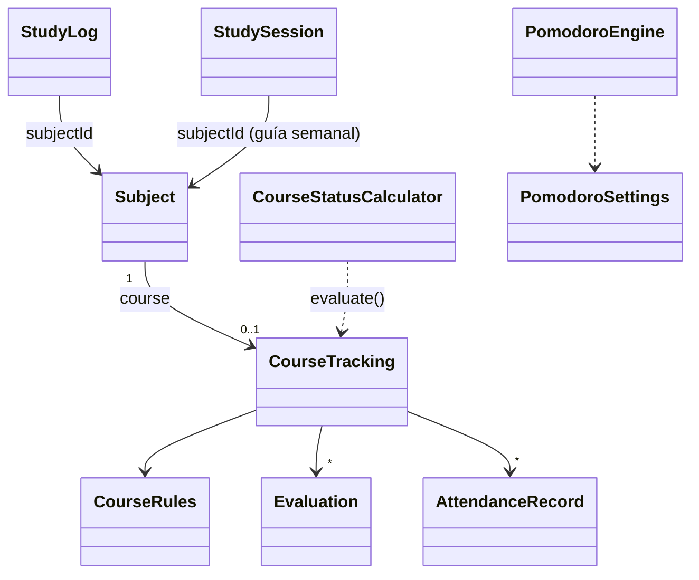

# Planificador de Estudio Desktop (Java)

Aplicación nativa de escritorio desarrollada en **Java (Swing + FlatLaf)** para la gestión completa de plan de estudio universitario, materias, guía semanal y fechas importantes.

## ✨ Funciones
- **Hoy**: lo planeado para hoy y la **cuenta regresiva** de las fechas importantes de los próximos 30 días ("Primer parcial (Mecánica de Fluidos) en 6 días"; en rojo las de 7 días o menos).
- **Guía semanal**, **Materias** (unidades y temas), **Fechas clave** y **Progreso**, como antes.
- **🍅 Pomodoro** (botón en Hoy y en Tiempo): elegís materia y, si querés, tema; ciclos de 25 min de estudio y 5 de descanso, con un descanso largo de 15 cada 4 ciclos. Los cuatro valores se cambian con **⚙ Ajustes**. Al terminar cada fase el reloj se frena y suena un aviso. Cada ciclo de estudio terminado se guarda como sesión de estudio (`studyLogs`); saltear una fase no guarda nada.
- **⏳ Tiempo**: por materia, lo estudiado con el Pomodoro en la semana elegida contra lo planeado en la guía semanal (suma de los minutos de la guía), y una tabla de las últimas 8 semanas.
- **🎓 Cursada**: por materia cargás las reglas (asistencia mínima, nota para regularizar y para promocionar, cantidad de parciales, cuáles tienen recuperatorio y cuántas clases tiene el cuatrimestre), las notas de parciales, recuperatorios y TP, y la asistencia de cada clase. Calcula la condición (**promoción, regular, libre o en curso**) y cuánto falta ("Podés faltar 2 clases más", "Parcial 2: falta rendir (necesitás 6 para regularizar y 8 para promocionar)").

### Reglas de cursada que usa el cálculo
- Asistencia = presentes / clases registradas. Si se cargó la cantidad de clases del cuatrimestre: faltas permitidas = ⌊clases × (100 − mínimo) / 100⌋ y queda libre si las supera. Si no se cargó: queda libre si el porcentaje actual es menor al mínimo.
- Un recuperatorio **reemplaza** la nota del parcial (aunque sea más baja). Si hay dos notas del mismo parcial, vale la última cargada.
- Un parcial desaprobado con recuperatorio todavía sin rendir está "a recuperar" (en curso); sin recuperatorio, o con el recuperatorio desaprobado, deja **libre**.
- **Promoción**: todos los parciales con nota ≥ la de promoción y la asistencia al día. **Regular**: todos ≥ la de regularizar. **En curso**: falta rendir o recuperar algún parcial, o faltan clases por registrar.
- Los TP se cargan y se muestran, pero no cambian la condición.

## 🚀 Requisitos
- Java JDK 21.
- Maven 3.9+.
- La librería `panel:sync-core:1.0.0-SNAPSHOT`, que no está en ningún repositorio público: vive en el repo `Panel` (`~/Escritorio/Hobbies/programacion/Proyectos/Panel`, rama `main`) y hay que instalarla en el Maven local antes de compilar. Desde la carpeta de ese repo:

```bash
mvn -q -pl sync-core -am install -DskipTests
```

En un clon limpio o en otra PC, `mvn compile` falla con un error de `panel:sync-core` sin resolver hasta que se haga esto. Después, desde la carpeta del Planificador, se compila como se explica abajo.

## 🛠️ Cómo Compilar y Ejecutar

### Opción 1: Ejecutar directamente con Maven
```bash
mvn clean compile exec:java -Dexec.mainClass="com.planificador.Main"
```

### Opción 2: Generar JAR Ejecutable y ejecutar
```bash
mvn clean package
java -jar target/planificador-estudio-desktop-1.0.0-jar-with-dependencies.jar
```

## 💾 Dónde se guardan los datos
Los datos viven siempre en el mismo archivo, sin importar desde qué carpeta se abra la app:

```
~/.local/share/planificador-estudio/planificador_datos.json
```

(o `$XDG_DATA_HOME/planificador-estudio/` si esa variable está definida). Las sesiones del Pomodoro (`studyLogs`), sus ajustes (`pomodoroSettings`) y la cursada de cada materia (`course`) van en el mismo archivo; son campos opcionales, así que un archivo de una versión anterior carga igual. Se guarda primero en un temporal y después se reemplaza, así un corte a mitad de escritura no deja el archivo roto. Si el archivo no se puede leer, se guarda una copia `planificador_datos.json.danado-<fecha>` antes de cargar los datos de ejemplo.

Las versiones anteriores guardaban `planificador_datos.json` en la carpeta desde donde se abría la app. Al primer inicio, si la ubicación nueva no existe, se **copia** el más reciente de esos archivos viejos (carpeta actual o carpeta personal); el original no se borra.

## Panel

El Planificador puede mandar lo que estudiás al **Panel**, el servidor personal donde se junta la actividad de gimnasio, running, estudio y demás (repo `Panel`). Es opcional: sin configurar, el programa funciona igual que siempre.

### Qué se manda y cuándo

- **Después de cada guardado** (y una vez al abrir el programa) se compara lo que tenés con lo que ya se mandó y se envía solo la diferencia. El envío corre en segundo plano: si el panel falla, el guardado no se entera.
- **La primera vez que lo activás se manda todo el historial** que ya tenías.
- **Estudio**: un registro **por materia y por día** que suma todos los ciclos del Pomodoro, cronómetros y sesiones de la guía marcadas ese día. En el panel aparece en el área Estudio con los minutos del día y, en el detalle, los temas estudiados. Un día que se queda sin minutos se borra del panel.
- **Fechas importantes**: **todas** (parcial, final, TP y entrega), como eventos del calendario del panel. Cada una lleva su tipo y, si tiene materia, los minutos que llevás estudiados de esa materia hasta hoy (o hasta la fecha del evento, si ya pasó). Si hay varias el mismo día, el panel muestra todas.
- **Notas de parciales** (con sus recuperatorios; los TP no): una por cada parcial con nota, como resultado de la métrica de la materia. Si un parcial tiene recuperatorio, vale el recuperatorio aunque sea más bajo que la nota original. Una nota sin fecha se manda con el día en que el programa la vio por primera vez.
- **Borrar en el Planificador borra en el panel**: un ciclo, una sesión de la guía desmarcada, una fecha importante, una nota o una materia desaparecen también de allá en el siguiente envío.

### Cómo configurarlo

Menú **Panel → Conexión con el panel…** y completá:

- **Dirección del panel**, por ejemplo `http://192.168.1.13:7070`.
- **Token** del dispositivo (campo de contraseña; la casilla **Mostrar** lo deja ver; no se escribe en ningún mensaje).
- **Dispositivo** (por ejemplo `pc`; el servidor igual lo reemplaza por el del token).
- La casilla **Enviar al panel**, que se puede destildar para pausar el envío sin perder la configuración.

Los botones son **Probar conexión**, **Reenviar todo al panel**, **Guardar** y **Cancelar**. **Probar conexión** verifica la dirección y el token sin guardar. **Reenviar todo al panel** olvida lo ya mandado y vuelve a mandar todo el historial, con la conexión que está guardada (no con lo que esté escrito sin guardar); sirve, por ejemplo, después de borrar cosas a mano en el panel. Si cambiás la dirección a otro servidor, el programa también olvida lo mandado y manda todo de nuevo.

### Dónde queda

Junto al archivo de datos, en `~/.local/share/planificador-estudio/` (o `$XDG_DATA_HOME/planificador-estudio/`):

- `panel-cliente.properties`: dirección, token, dispositivo y si se envía (permisos 600 cuando el sistema lo permite).
- `panel-cola.jsonl`: lo que todavía no llegó al panel. Solo existe si la conexión está activa.
- `panel-estado.json`: lo último que se mandó de cada registro y las fechas recordadas de las notas sin fecha. Si se borra o se daña, el programa vuelve a mandar todo (los envíos son idempotentes).

**Sin configuración no cambia nada**: si falta la dirección o el token, o la casilla está destildada, no se crean estos archivos, no se usa la red y no aparece ningún aviso.

### Si el panel está apagado

El guardado no se interrumpe: lo que no se pudo entregar queda en `panel-cola.jsonl` y un hilo en segundo plano lo reintenta con espera creciente hasta que el panel vuelva (también al abrir el programa de nuevo).

### Guardas contra borrados por error

Para no vaciar el panel por un problema local, **no se manda ningún borrado** cuando el archivo de datos estaba dañado al abrir el programa (arranca vacío y avisa), cuando no quedó nada para mandar o cuando no se pudo armar parte de los datos. Esa guarda dura hasta que, tras reiniciar el programa, los datos carguen bien otra vez. Lo nuevo y lo que cambió sí se sigue mandando.

### Qué muestra el panel

- **Estudio**: cada día con estudio es una celda del calendario del área Estudio; el detalle del día lista, por materia, los minutos y los temas.
- **Fechas importantes**: aparecen en el calendario del mes y en el día, con la nota "Llevás X de estudio en la materia".
- **Notas**: sirven para crear una **meta** en el panel, por ejemplo "aprobar Mecánica de Fluidos" de 0 a la nota de aprobación, con la métrica `nota:<clave de la materia>`. El panel toma la **mejor** nota registrada para esa métrica como progreso; es una limitación conocida (no distingue entre parciales).

La clave sale del nombre de la materia: minúsculas, sin tildes, y todo lo que no sea letra o número pasa a un guion (sin guiones en los extremos). Ejemplos: `Mecánica de Fluidos` → `nota:mecanica-de-fluidos`, `Análisis Matemático II` → `nota:analisis-matematico-ii`. Una materia cuyo nombre no deja ninguna clave no manda notas. Si renombrás una materia, su clave cambia: sus notas se reenvían con la clave nueva en el siguiente guardado, pero una meta creada con la clave vieja deja de moverse y hay que crearla de nuevo con la clave nueva.

### Probar de punta a punta

La prueba `PanelExtremoAExtremoManualTest` arma datos de ejemplo con las clases reales (carpeta temporal, nunca tus datos), los manda a un panel de verdad y verifica lo que quedó: estudio por materia y día, fechas, notas y progreso de la meta, que sincronizar de nuevo no duplica nada, el borrado de un ciclo y de un día entero, y el caso del panel caído. Solo corre si están definidas `PANEL_E2E_URL` y `PANEL_E2E_TOKEN`; con `mvn test` común se omite sola.

Levantar un panel de demostración (en el repo `Panel`; usa una base temporal en el puerto 8099 con token `demo`, y se detiene con Ctrl+C):

```bash
cd ~/Escritorio/Hobbies/programacion/Proyectos/Panel && scripts/demo.sh
```

Correr la prueba contra ese panel, desde otra terminal y en la carpeta del Planificador:

```bash
PANEL_E2E_URL=http://localhost:8099 PANEL_E2E_TOKEN=demo mvn test -Dtest=PanelExtremoAExtremoManualTest
```

## 🧪 Tests
```bash
mvn test
```
Los tests nunca tocan los datos reales: usan carpetas temporales (`XDG_DATA_HOME` apunta a `target/` y `java.awt.headless=true`). `PantallasTest` arma y dibuja todas las pantallas sin abrir ventanas; con `-Dcapturas=<carpeta>` guarda una imagen de cada una.

Esta etapa la programaron modelos locales (qwen3.5-9b y Gemma 4 E4B) con Claude diseñando y evaluando: ver `docs/llm/`.

## 📂 Estructura del Proyecto
- `com.planificador.Main`: Punto de entrada de la aplicación.
- `com.planificador.panel`: conexión con el Panel (`RegistrosPanel`, `PanelSincronizador`, `EstadoPanel`).
- `com.planificador.model`: Modelos de datos (Subject, Unit, Topic, StudySession, ImportantDate; nuevos: StudyLog, PomodoroSettings, CourseRules, CourseTracking, Evaluation, AttendanceRecord).
- `com.planificador.service`: `DataManager` (JSON) y la lógica nueva, sin Swing y con tests: `Countdown`, `StudyTimeStats`, `PomodoroEngine`, `StudyLogFactory`, `CourseStatusCalculator`.
- `com.planificador.ui`: Swing (MainWindow, TodayPanel, WeeklyPanel, SubjectsPanel, DatesPanel, StatsPanel, TimerDialog; nuevos: CountdownPanel, PomodoroPanel, PomodoroDialog, StudyTimePanel, CoursePanel, CourseRulesForm, EvaluationForm).


